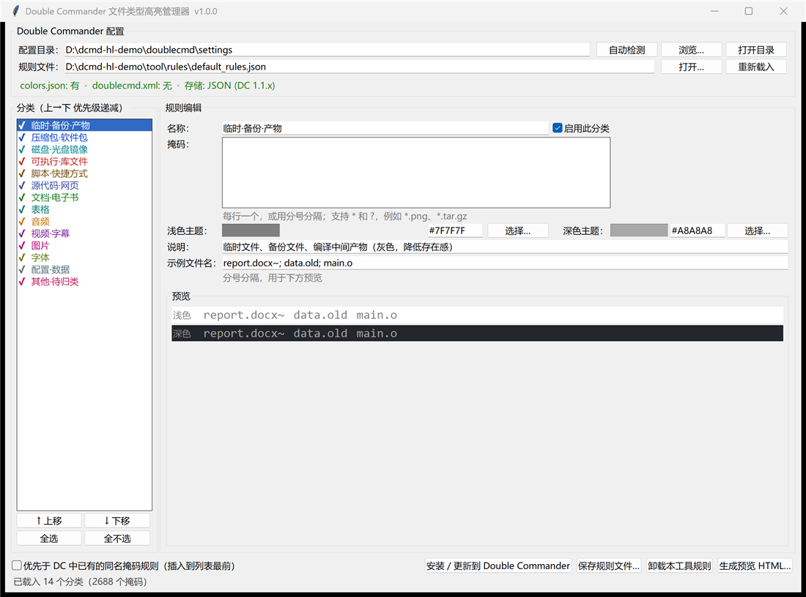

# Double Commander 文件类型高亮

按**文件扩展名/掩码**给 Double Commander 文件面板中的**文件名**上色 —— 压缩包蓝色、图片品红、代码靛蓝、音频橙色……效果等同于官方设置「选项 → 颜色 → 文件类型颜色」，并附带 **14 个分类、2688 条掩码**的规则包、图形界面与一键安装工具。

* **Windows 免 Python 一键安装**：Windows 7 SP1 / 8 / 8.1 / 10 / 11（提供 **win64** 与 **win32** 两个包）
* **Linux 一键安装**：Ubuntu / Debian / Fedora / RHEL / openSUSE / Arch 等主流发行版，提供通用 `tar.gz`、`.deb`、`.rpm`
* 兼容 Double Commander **1.0.x**（`doublecmd.xml`）与 **1.1.x / 1.2.x**（`colors.json`）
* **便携版 / 安装版**均支持：便携版可把 DC 程序文件夹（或 `settings` 文件夹、`doublecmd.exe`）**直接拖到安装窗口**上自动定位
* 写入前**自动备份**，可一键卸载 / 还原；不影响你自己的其它规则
* 不改动 Double Commander 一行源码



## 特性

* **开箱即用的规则包**：14 个分类 / 2688 条掩码，浅色 + 深色两套主题配色
* **Windows 免安装 Python**：[Releases](../../releases/latest) 的压缩包内 exe 已内置 Python 运行时：解压 → `install.cmd` → 重启 DC 即可
* **Linux 原生支持**：自动识别 `~/.config/doublecmd`、便携版 `settings`、Flatpak、Snap；`tar.gz` 一键脚本无需 root，`.deb` / `.rpm` 走系统包管理
* **图形界面**：分类勾选、优先级排序、颜色编辑、实时预览、一键写入 DC 配置
* **命令行工具**：探测配置目录、试运行、按分类安装/排除、卸载、备份/还原、生成预览
* **扩展名扫描（`scan`）**：扫描磁盘上真实出现的扩展名，自动归类补全规则（认不出的进「其他·待归类」），保证所有文件类型都有颜色
* **安全的写入方式**：DC 运行时拒绝写入（避免退出时被覆盖）、写入前自动备份、原子替换、保留原文件权限

## 下载安装（一键）

### Windows

1. 到 [Releases](../../releases/latest) 下载压缩包 —— **按你的 Windows 位数选**：

   | 你的系统 | 下载 |
   | --- | --- |
   | 64 位 Windows（绝大多数情况） | `dcmd-filetypes-highlight-1.1.0-win64.zip` |
   | 32 位 Windows | `dcmd-filetypes-highlight-1.1.0-win32.zip` |

   > 不确定？打开「设置 → 系统 → 关于」（Win7：右键“计算机”→“属性”），看“系统类型”。也可以在解压后直接双击 `install.cmd`：装错包时它会明确提示你该换哪个。
   > 提示：工具包的位数与你 Double Commander 的位数**无关**（32/64 位 DC 都可使用），只取决于你的 Windows。

2. 解压到任意可写目录；**完全退出 Double Commander**（含托盘图标）
3. 双击 **`install.cmd`**，按屏幕提示操作，看到 `[DONE]` 即安装成功
4. 启动 Double Commander —— 文件面板里的文件名就会按类型着色

`install.cmd` 会自动探测 DC 配置目录（运行中的 DC 进程 / 解压目录附近 / 常见安装位置 / `%APPDATA%`），找到后会请你**回车确认**，也支持：

* 把 DC 的**程序文件夹**、**`settings` 文件夹**或 **`doublecmd.exe`** 从资源管理器**拖进窗口**后回车；
* 直接回车（探测不到时）弹出**文件夹选择框**；
* 或者带参数运行：

```bat
install.cmd "D:\Tools\doublecmd"                    :: 便携版：DC 程序文件夹（自动找它的 settings）
install.cmd -c "D:\Tools\doublecmd\settings"        :: 便携版：配置目录（含 colors.json / doublecmd.inf）
install.cmd -c "C:\Users\你的用户名\AppData\Roaming\doublecmd"   :: 安装版
```

等价的命令行写法：

```bat
dcmd_hl_cli.exe install "D:\Tools\doublecmd"          :: 程序文件夹 / settings / doublecmd.exe 都识别
dcmd_hl_cli.exe install -c "D:\Tools\doublecmd\settings"
dcmd_hl_cli.exe install --exe "D:\Tools\doublecmd\doublecmd.exe"
```

> 便携版的配置目录一般是 **`<DC 程序目录>\settings`**（判断标志：里面有 `doublecmd.inf` 或 `colors.json`）。
> 便携包**从未启动过 DC 也能安装**（安装包自带的 `settings\doublecmd.inf` 就足以被识别）；安装完成后启动 DC 即可看到颜色。

### Linux（Ubuntu / Debian / Fedora / RHEL / openSUSE / Arch 等）

**最省事：一行命令（不需要 sudo）**

```bash
curl -fsSL https://github.com/BGGeorge/doublecmd-filetypes-highlight/releases/latest/download/install-linux.sh | bash
```

它会下载通用安装包并做 SHA256 校验，然后把程序装到你的用户目录（`~/.local/share/dcmd-filetypes-highlight`），创建 `dcmd-hl` / `dcmd-hl-gui` 命令和桌面菜单入口，最后自动探测 DC 配置目录、备份并写入规则。

> 安装前请**完全退出 Double Commander**。装完重新启动 DC 即可看到文件名按类型着色。

**按发行版选择安装包**（都在 [Releases](../../releases/latest) 页面）：

| 你的系统 | 推荐文件 | 安装方式 |
| --- | --- | --- |
| 任意发行版（通用，无需 root） | `dcmd-filetypes-highlight-1.1.0-linux.tar.gz` | 解压后 `bash install.sh` |
| Ubuntu / Debian / Mint / Pop!_OS | `dcmd-filetypes-highlight_1.1.0_all.deb` | `sudo apt install ./dcmd-filetypes-highlight_1.1.0_all.deb` |
| Fedora / RHEL / Rocky / AlmaLinux / openSUSE | `dcmd-filetypes-highlight-1.1.0-1.noarch.rpm` | `sudo dnf install ./dcmd-filetypes-highlight-1.1.0-1.noarch.rpm`（openSUSE 用 `sudo zypper install ./...`） |
| Arch / Manjaro | 通用 `tar.gz` | 解压后 `bash install.sh` |

通用包手动安装：

```bash
tar -xzf dcmd-filetypes-highlight-1.1.0-linux.tar.gz
cd dcmd-filetypes-highlight-1.1.0-linux
bash install.sh            # 自动探测 DC 配置并写入；不会动你自己的规则
```

`.deb` / `.rpm` 只安装系统程序，不会（也不应该）替某个用户改 `~/.config/doublecmd`。装完后：

* **图形界面**：打开应用菜单，搜索“Double Commander 文件类型高亮”，点“安装 / 更新到 Double Commander”；
* **或命令行**：终端执行 `dcmd-hl install`。

> 图形界面需要 Python 的 tkinter。Ubuntu/Debian 装 `python3-tk`，Fedora 装 `python3-tkinter`，Arch 装 `tk`，openSUSE 装 `python3-tk`。没有 tkinter 也可以用 `dcmd-hl` 命令行完成全部操作。

**新手图文教程（含 DC 安装、各发行版命令、FAQ、卸载）**：[docs/Linux安装教程.md](docs/Linux安装教程.md)

## 从源码运行（需要 Python 3.8+）

```bat
git clone https://github.com/BGGeorge/doublecmd-filetypes-highlight.git
cd doublecmd-filetypes-highlight

python src\dcmd_hl_gui.py        :: 图形界面
python src\dcmd_hl.py menu       :: 中文交互菜单（等价于双击 src\dcmd_hl_cli.cmd）
python src\dcmd_hl.py detect     :: 探测 DC 配置目录
python src\dcmd_hl.py install    :: 写入 DC 配置（自动备份）
```

Linux / macOS 源码方式（Python 3.8+，GUI 需要 tkinter）：

```bash
git clone https://github.com/BGGeorge/doublecmd-filetypes-highlight.git
cd doublecmd-filetypes-highlight

python3 src/dcmd_hl_gui.py       # 图形界面（或运行 src/dcmd_hl_gui.sh）
python3 src/dcmd_hl.py menu      # 中文交互菜单（或运行 src/dcmd_hl_cli.sh）
python3 src/dcmd_hl.py detect    # 探测 DC 配置目录
python3 src/dcmd_hl.py install   # 写入 DC 配置（自动备份）
```

源码无第三方依赖，只用标准库（tkinter 界面）。

## 兼容性

| 项目 | 支持范围 |
| --- | --- |
| Windows | 7 SP1 / 8 / 8.1 / 10 / 11；**64 位**用 `win64` 包，**32 位**用 `win32` 包（ARM64 设备建议用 `win32` 包，或源码方式运行） |
| Linux | Ubuntu 20.04+ / Debian 11+ / Linux Mint / Fedora 38+ / RHEL 9+ / Rocky / AlmaLinux / openSUSE / Arch / Manjaro 等主流发行版；x86_64 与 arm64 均可使用通用包 |
| Double Commander | 1.0.x（`doublecmd.xml`）与 1.1.x / 1.2.x（`colors.json`）；Windows / Linux 的便携版、安装版、Flatpak、Snap 均可；32 / 64 位 DC 均可 |
| 运行依赖 | Windows：无（exe 内置运行时）；Linux：`python3`（3.8+，发行版通常自带），GUI 另需 tkinter（Ubuntu/Debian `python3-tk`，Fedora `python3-tkinter`，Arch `tk`）；源码方式需要 Python 3.8+ |

* **Win7**：需已安装 SP1 与常规系统更新（Universal C Runtime）。首次运行 exe 若出现 SmartScreen 提示，点“更多信息 → 仍要运行”即可。
* **Linux 配置目录**：普通安装版为 `~/.config/doublecmd`（遵循 `XDG_CONFIG_HOME`）；便携版为 `<DC 程序目录>/settings`；Flatpak 为 `~/.var/app/<AppID>/config/doublecmd`；Snap 为 `~/snap/<名称>/current/.config/doublecmd`。工具会自动识别。
* 配置目录自动探测顺序（Windows）：显式指定（`-c` / `--exe` / 位置参数）→ 运行中的 DC 进程 → **解压目录附近**（父目录、`*doublecmd*` 子目录，覆盖便携版）→ 上次安装记录 → 常见安装位置 → `%APPDATA%\doublecmd` → `%LOCALAPPDATA%\doublecmd`。给的是 DC 程序目录 / `doublecmd.exe` 时会自动定位到 `<程序目录>\settings` 或 `%APPDATA%`。
* 配置目录自动探测顺序（Linux）：显式指定 → 运行中的 DC 进程（`/proc`）→ 解压目录附近 → 上次安装记录 → 便携版 `settings` → `~/.config/doublecmd` → Flatpak / Snap。

## 规则包

规则按列表顺序匹配，**第一个命中的规则生效**（与 DC/TC 行为一致）。

| id | 名称 | 掩码数 | 浅色主题 | 深色主题 |
| --- | --- | ---: | --- | --- |
| `temp` | 临时·备份·产物 | 40 | `#7F7F7F` | `#A8A8A8` |
| `archives` | 压缩包·软件包 | 83 | `#0047CC` | `#82B1FF` |
| `diskimages` | 磁盘·光盘镜像 | 25 | `#00838F` | `#4DD0E1` |
| `executables` | 可执行·库文件 | 47 | `#C62828` | `#FF7A7A` |
| `scripts` | 脚本·快捷方式 | 38 | `#7B4B00` | `#D7A86E` |
| `code` | 源代码·网页 | 216 | `#3949AB` | `#9FA8FF` |
| `documents` | 文档·电子书 | 87 | `#1B7F1B` | `#7CD87C` |
| `spreadsheets` | 表格 | 20 | `#00796B` | `#66D9C8` |
| `audio` | 音频 | 49 | `#C07500` | `#FFC46B` |
| `video` | 视频·字幕 | 49 | `#7B1FA2` | `#C79BFF` |
| `images` | 图片 | 100 | `#B4007B` | `#FF7BD5` |
| `fonts` | 字体 | 25 | `#6B7A00` | `#C9D86B` |
| `configs` | 配置·数据 | 218 | `#546E7A` | `#9FB8C4` |
| `other` | 其他·待归类 | 1691 | `#C2185B` | `#FF80AB` |

> 前 13 个分类手工策展（538 条掩码，覆盖常见格式）；`other`（其他·待归类）由 `scan` 自动维护 —— 凡是暂时认不出归属、但在你的磁盘上真实出现的扩展名都会进这里，保证“所有文件类型都有高亮”。

## 扩展名扫描（scan）

```bat
dcmd_hl_cli.exe scan D:\Media --top 300            :: 只出报告：未覆盖的扩展名及归类建议
dcmd_hl_cli.exe scan D:\Media --apply              :: 把新扩展名归类写回规则包（自动备份）
dcmd_hl_cli.exe scan D:\Media --apply --install    :: 再顺手安装到 DC 配置
```

* 只枚举**文件名**，不读文件内容（个别无法判断的格式会抽样读文件头魔数），数十万文件数秒完成；自动跳过 `node_modules`、`.git`、Windows/Program Files、AppData、系统卷目录等
* 归类顺序：扩展名对照表 → 文件头魔数（PE/ZIP/PDF/PNG/MP3/Matroska/SQLite…）→ 文本启发（XML/JSON/shebang…）→ 认不出的进「其他·待归类」
* 写入规则包前自动备份为 `default_rules.json.fth-backup-<时间戳>`

## 卸载 / 还原 / 安全

```bat
dcmd_hl_cli.exe uninstall    :: 只删本工具安装的规则，你自己的规则不受影响
dcmd_hl_cli.exe backups      :: 列出所有备份
dcmd_hl_cli.exe restore <备份文件> -y
```

Linux 等价操作：

```bash
dcmd-hl uninstall                 # 只删本工具写入的规则
dcmd-hl backups                   # 列出备份
dcmd-hl restore <备份文件> -y     # 整文件还原

# 卸载程序本身（保留 DC 里已安装的颜色规则）
bash install.sh --uninstall                 # tar.gz 安装方式
sudo apt remove dcmd-filetypes-highlight    # .deb
sudo dnf remove dcmd-filetypes-highlight    # .rpm（openSUSE 用 zypper remove）

# 连 DC 里的颜色规则和安装记录一起移除
bash install.sh --uninstall --purge
```

* 每次写入前自动备份为 `<原文件>.fth-backup-<时间戳>`（就在 DC 配置目录里）
* 同名规则原地更新；未勾选的旧规则自动移除；你的其它规则原样保留；默认追加到规则表末尾（优先级最低，`--prepend` 可插到最前）
* 也可以安装后直接打开 DC：**配置 → 选项 → 颜色 → 文件类型颜色**，所有规则都在，可继续手工编辑

## 常见问题

**装完颜色没变化？**
重启 DC（DC 在启动/退出时读写配置）。若仍无变化：`dcmd_hl_cli.exe detect` 确认探测到的配置目录就是 DC 实际在用的那个。

**提示“Double Commander 正在运行，拒绝写入”？**
DC 退出时会把内存中的设置写回配置文件、覆盖修改。请完全退出 DC（含托盘图标）后再安装。确实要强写可加 `--force`（不推荐）。

**便携版不知道怎么装？**
双击 `install.cmd` 后，把 DC 的程序文件夹（含 `doublecmd.exe`）**拖进窗口**再回车即可，工具会自动使用 `<程序目录>\settings`；也可以直接回车让工具弹出文件夹选择框。若你之前误装到了 `%APPDATA%\doublecmd`（安装版的位置），重装到便携版目录即可——两者互不影响，`dcmd_hl_cli.exe status` 可随时查看当前写入的是哪个目录。

**控制台里中文乱码？**
真实控制台窗口显示正常；输出重定向到文件时是 UTF-8 编码，请用支持 UTF-8 的查看器打开。

**`.ts` 被当成源代码，我想当视频？**
打开 GUI，把 `*.ts` 从“源代码·网页”挪到“视频·字幕”再点“安装 / 更新”；或直接编辑 `rules\default_rules.json`。

**Linux 下提示 `dcmd-hl: command not found`？**
通用安装脚本装到 `~/.local/bin`，部分发行版默认不把这个目录放进 `PATH`。可以重新登录一次，或执行：

```bash
echo 'export PATH="$HOME/.local/bin:$PATH"' >> ~/.profile
source ~/.profile
```

也可以一直用绝对路径 `~/.local/bin/dcmd-hl`。

**Linux 图形界面打不开 / 提示 `No module named tkinter`？**
安装 tkinter 后重试：Ubuntu/Debian `sudo apt install python3-tk`；Fedora `sudo dnf install python3-tkinter`；Arch `sudo pacman -S tk`；openSUSE `sudo zypper install python3-tk`。没有图形界面时，`dcmd-hl` 命令行的功能完全相同。

**Linux 装完是一行命令，但 DC 没有变化？**
先完全退出 DC（包括托盘图标）再启动；然后用 `dcmd-hl status` 检查写入的是不是 DC 实际使用的配置目录。Flatpak / Snap 版 DC 的配置目录不同，工具会自动尝试，也可以用 `dcmd-hl status -c <目录>` 明确指定。

更多问题与技术细节见 [docs/技术文档.md](docs/技术文档.md)；Linux 专属问题见 [docs/Linux安装教程.md](docs/Linux安装教程.md)。

## 仓库结构

```
doublecmd-filetypes-highlight/
├─ src/                     Python 源码 + Windows / Linux 启动器
│  ├─ dcmd_hl.py            核心工具（探测、安装、卸载、备份、预览、导出、扫描）
│  ├─ dcmd_hl_gui.py        图形界面（tkinter，无第三方依赖）
│  ├─ dcmd_hl_cli.cmd/.sh   Windows / Linux 命令行启动器
│  └─ dcmd_hl_gui.cmd/.sh   Windows / Linux 图形界面启动器
├─ rules/
│  └─ default_rules.json    规则包（14 分类 / 2688 条掩码，可由 scan 继续扩充）
├─ docs/
│  ├─ gui.png               界面截图
│  ├─ icon.svg              Linux 菜单图标
│  ├─ 技术文档.md           原理、源码依据、规则格式、分类详解
│  └─ Linux安装教程.md      Linux 小白图文教程（各发行版、FAQ、卸载）
├─ packaging/
│  ├─ build.ps1             构建 Windows 发行包（win64/win32 各构建一次）
│  ├─ install.cmd           包内“一键安装”脚本（含位数检查、拖拽定位、文件夹选择器）
│  ├─ pick-folder.ps1       install.cmd 调用的文件夹选择对话框
│  ├─ README-package.md     发行包内附的用户指南
│  └─ linux/
│     ├─ install.sh         通用 tar.gz 一键安装 / 卸载脚本（无需 root）
│     ├─ install-linux.sh.in 在线安装器模板
│     ├─ build_linux.py     构建 tar.gz / .deb / .rpm / SHA256SUMS
│     ├─ system/            系统级启动器、.desktop、包脚本
│     └─ tests/             Python 测试与 Shell 检查
├─ .github/workflows/linux-ci.yml  Ubuntu / Fedora CI（构建、安装、卸载验证）
├─ README.md
└─ LICENSE
```

## 构建发行包

Windows（需要 Python 3.8 —— 最后支持 Win7 的版本 —— 以及 `pyinstaller==4.10`；win64 用 64 位解释器，win32 用 32 位解释器，各构建一次）：

```powershell
python -m pip install pyinstaller==4.10
powershell -ExecutionPolicy Bypass -File packaging\build.ps1 -Python "C:\Python38-x64\python.exe" -Arch win64 -Version 1.1.0
powershell -ExecutionPolicy Bypass -File packaging\build.ps1 -Python "C:\Python38-x86\python.exe" -Arch win32 -Version 1.1.0
```

Linux（Python 3.8+；生成 `.deb` / `.rpm` 需要 [nfpm](https://nfpm.goreleaser.com)）：

```bash
python3 packaging/linux/build_linux.py --nfpm nfpm
# 产物在 _dist/linux/：tar.gz、.deb、.rpm、install-linux.sh、SHA256SUMS
```

推送到 `main` 后，GitHub Actions 会在 Ubuntu 与 Fedora 上自动构建并实际安装/卸载，验证脚本和包内容（见 `.github/workflows/linux-ci.yml`）。

## 为什么不是传统插件？

Double Commander 的 5 类插件（WCX/WDX/WFX/WLX/DSX）都没有“给面板文件名重新着色”的接口；
本扩展包走的是与 DC 官方设置对话框完全相同的路线 —— 把「文件类型颜色」规则写进 DC 自己的配置文件，效果、兼容性与可撤销性和手工逐条添加完全一致。详见 [docs/技术文档.md](docs/技术文档.md)。

## 许可与免责声明

* 本项目以 **MIT** 许可证开源，见 [LICENSE](LICENSE)。
* **非官方项目**：与 Double Commander 官方项目无隶属关系；“Double Commander” 名称与商标归其所有者。
* 工具只写入 DC 自己的配置文件（改前自动备份、原子替换），不写注册表、不联网；修改配置的风险由使用者自行评估。
