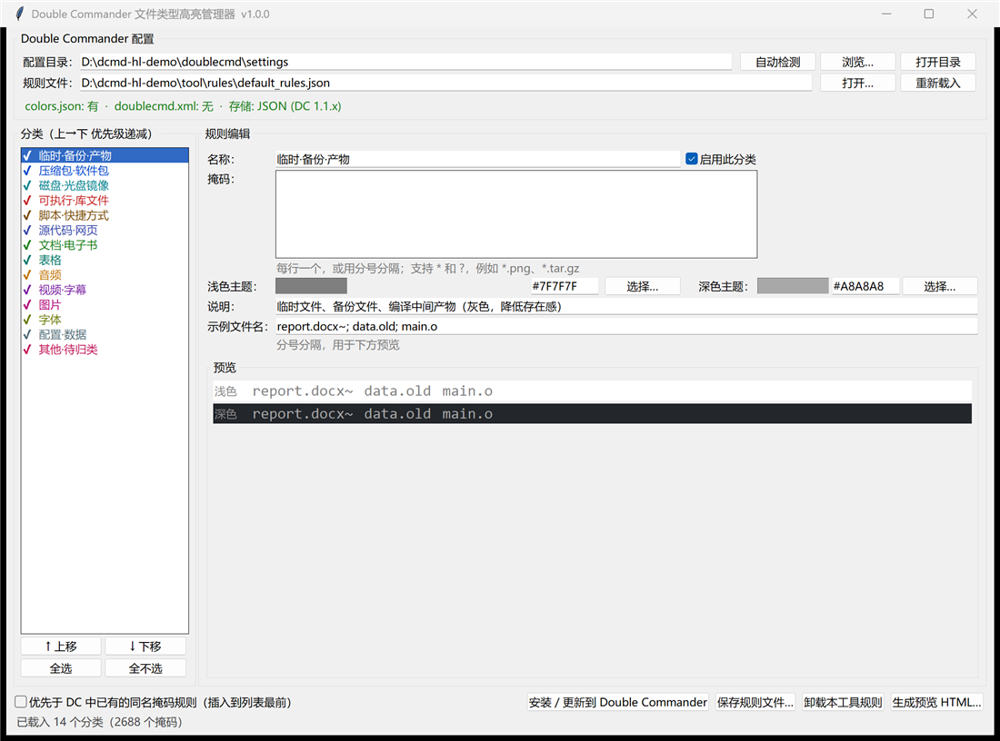

# Double Commander 文件类型高亮

按**文件扩展名/掩码**给 Double Commander 文件面板中的**文件名**上色 —— 压缩包蓝色、图片品红、代码靛蓝、音频橙色……效果等同于官方设置「选项 → 颜色 → 文件类型颜色」，并附带 **14 个分类、2688 条掩码**的规则包、图形界面与一键安装工具。

* **免 Python 一键安装**：Windows 7 SP1 / 8 / 8.1 / 10 / 11（64 位）
* 兼容 Double Commander **1.1.x**（`colors.json`）与 **1.0.x**（`doublecmd.xml`）
* 写入前**自动备份**，可一键卸载 / 还原；不影响你自己的其它规则
* 不改动 Double Commander 一行源码



## 特性

* **开箱即用的规则包**：14 个分类 / 2688 条掩码，浅色 + 深色两套主题配色
* **免安装 Python**：[Releases](../../releases/latest) 的压缩包内 exe 已内置 Python 运行时：解压 → `install.cmd` → 重启 DC 即可
* **图形界面**：分类勾选、优先级排序、颜色编辑、实时预览、一键写入 DC 配置
* **命令行工具**：探测配置目录、试运行、按分类安装/排除、卸载、备份/还原、生成预览
* **扩展名扫描（`scan`）**：扫描磁盘上真实出现的扩展名，自动归类补全规则（认不出的进「其他·待归类」），保证所有文件类型都有颜色
* **安全的写入方式**：DC 运行时拒绝写入（避免退出时被覆盖）、写入前自动备份、原子替换

## 下载安装（一键）

1. 到 [Releases](../../releases/latest) 下载 `dcmd-filetypes-highlight-1.0.0.zip`
2. 解压到任意可写目录；**完全退出 Double Commander**（含托盘图标）
3. 双击 **`install.cmd`**，看到 `[DONE]` 即安装成功
4. 启动 Double Commander —— 文件面板里的文件名就会按类型着色

如果脚本提示找不到配置目录，改用下面任一方式指定（路径换成你自己的）：

```bat
dcmd_hl_cli.exe install -c "C:\Users\你的用户名\AppData\Roaming\doublecmd"   :: 普通安装版
dcmd_hl_cli.exe install -c "D:\Tools\doublecmd\settings"                     :: 便携版（一般是 <程序目录>\settings）
dcmd_hl_cli.exe install --exe "D:\Tools\doublecmd\doublecmd.exe"             :: 指向 doublecmd.exe 也行
```

## 从源码运行（需要 Python 3.8+）

```bat
git clone https://github.com/BGGeorge/doublecmd-filetypes-highlight.git
cd doublecmd-filetypes-highlight

python src\dcmd_hl_gui.py        :: 图形界面
python src\dcmd_hl.py menu       :: 中文交互菜单（等价于双击 src\dcmd_hl_cli.cmd）
python src\dcmd_hl.py detect     :: 探测 DC 配置目录
python src\dcmd_hl.py install    :: 写入 DC 配置（自动备份）
```

源码无第三方依赖，只用标准库（tkinter 界面）。

## 兼容性

| 项目 | 支持范围 |
| --- | --- |
| Windows | 7 SP1 / 8 / 8.1 / 10 / 11，**64 位**（32 位系统请用源码方式运行） |
| Double Commander | 1.1.x（实测 1.1.32）与 1.0.x；便携版 / 安装版均可 |
| 运行依赖 | 无（exe 内置运行时）；源码方式需要 Python 3.8+ |

* **Win7**：需已安装 SP1 与常规系统更新（Universal C Runtime）。首次运行 exe 若出现 SmartScreen 提示，点“更多信息 → 仍要运行”即可。
* 配置目录自动探测顺序：显式 `--exe`/`-c` → 运行中的 DC 进程 → 常见安装位置 → 上次安装记录 → `%APPDATA%\doublecmd` → `%LOCALAPPDATA%\doublecmd`。

## 规则包

规则按列表顺序匹配，**第一个命中的规则生效**（与 DC/TC 行为一致）。

| id | 名称 | 掩码数 | 浅色主题 | 深色主题 |
| --- | --- | ---: | --- | --- |
| `temp` | 临时·备份·产物 | 40 | `#7F7F7F` | `#A8A8A8` |
| `archives` | 压缩包·软件包 | 83 | `#0047CC` | `#82B1FF` |
| `diskimages` | 磁盘·光盘镜像 | 25 | `#00838F` | `#4DD0E1` |
| `executables` | 可执行·库文件 | 47 | `#C62828` | `#FF7A7A` |
| `scripts` | 脚本·快捷方式 | 38 | `#7B4B00` | `#D7A86E` |
| `code` | 源代码·网页 | 216 | `#3949AB` | `#9FA8FF` |
| `documents` | 文档·电子书 | 87 | `#1B7F1B` | `#7CD87C` |
| `spreadsheets` | 表格 | 20 | `#00796B` | `#66D9C8` |
| `audio` | 音频 | 49 | `#C07500` | `#FFC46B` |
| `video` | 视频·字幕 | 49 | `#7B1FA2` | `#C79BFF` |
| `images` | 图片 | 100 | `#B4007B` | `#FF7BD5` |
| `fonts` | 字体 | 25 | `#6B7A00` | `#C9D86B` |
| `configs` | 配置·数据 | 218 | `#546E7A` | `#9FB8C4` |
| `other` | 其他·待归类 | 1691 | `#C2185B` | `#FF80AB` |

> 前 13 个分类手工策展（538 条掩码，覆盖常见格式）；`other`（其他·待归类）由 `scan` 自动维护 —— 凡是暂时认不出归属、但在你的磁盘上真实出现的扩展名都会进这里，保证“所有文件类型都有高亮”。

## 扩展名扫描（scan）

```bat
dcmd_hl_cli.exe scan D:\Media --top 300            :: 只出报告：未覆盖的扩展名及归类建议
dcmd_hl_cli.exe scan D:\Media --apply              :: 把新扩展名归类写回规则包（自动备份）
dcmd_hl_cli.exe scan D:\Media --apply --install    :: 再顺手安装到 DC 配置
```

* 只枚举**文件名**，不读文件内容（个别无法判断的格式会抽样读文件头魔数），数十万文件数秒完成；自动跳过 `node_modules`、`.git`、Windows/Program Files、AppData、系统卷目录等
* 归类顺序：扩展名对照表 → 文件头魔数（PE/ZIP/PDF/PNG/MP3/Matroska/SQLite…）→ 文本启发（XML/JSON/shebang…）→ 认不出的进「其他·待归类」
* 写入规则包前自动备份为 `default_rules.json.fth-backup-<时间戳>`

## 卸载 / 还原 / 安全

```bat
dcmd_hl_cli.exe uninstall    :: 只删本工具安装的规则，你自己的规则不受影响
dcmd_hl_cli.exe backups      :: 列出所有备份
dcmd_hl_cli.exe restore <备份文件> -y
```

* 每次写入前自动备份为 `<原文件>.fth-backup-<时间戳>`（就在 DC 配置目录里）
* 同名规则原地更新；未勾选的旧规则自动移除；你的其它规则原样保留；默认追加到规则表末尾（优先级最低，`--prepend` 可插到最前）
* 也可以安装后直接打开 DC：**配置 → 选项 → 颜色 → 文件类型颜色**，所有规则都在，可继续手工编辑

## 常见问题

**装完颜色没变化？**
重启 DC（DC 在启动/退出时读写配置）。若仍无变化：`dcmd_hl_cli.exe detect` 确认探测到的配置目录就是 DC 实际在用的那个。

**提示“Double Commander 正在运行，拒绝写入”？**
DC 退出时会把内存中的设置写回配置文件、覆盖修改。请完全退出 DC（含托盘图标）后再安装。确实要强写可加 `--force`（不推荐）。

**控制台里中文乱码？**
真实控制台窗口显示正常；输出重定向到文件时是 UTF-8 编码，请用支持 UTF-8 的查看器打开。

**`.ts` 被当成源代码，我想当视频？**
打开 GUI，把 `*.ts` 从“源代码·网页”挪到“视频·字幕”再点“安装 / 更新”；或直接编辑 `rules\default_rules.json`。

更多问题与技术细节见 [docs/技术文档.md](docs/技术文档.md)。

## 仓库结构

```
doublecmd-filetypes-highlight/
├─ src/                     Python 源码（dcmd_hl.py / dcmd_hl_gui.py）+ 双击启动器（.cmd）
├─ rules/
│  └─ default_rules.json    规则包（14 分类 / 2688 条掩码，可由 scan 继续扩充）
├─ docs/
│  ├─ gui.png               界面截图
│  └─ 技术文档.md           原理、源码依据、规则格式、分类详解
├─ packaging/
│  ├─ build.ps1             构建 Windows 发行包（Python 3.8 + PyInstaller 4.10）
│  ├─ install.cmd           包内“一键安装”脚本（随发行包分发）
│  └─ README-package.md     发行包内附的用户指南
├─ README.md
└─ LICENSE
```

## 构建发行包

```powershell
# 需要 Python 3.8 x64（最后支持 Win7 的版本）并安装 pyinstaller==4.10
python -m pip install pyinstaller==4.10
powershell -ExecutionPolicy Bypass -File packaging\build.ps1 -Python "C:\Python38\python.exe" -Version 1.0.0
```

## 为什么不是传统插件？

Double Commander 的 5 类插件（WCX/WDX/WFX/WLX/DSX）都没有“给面板文件名重新着色”的接口；
本扩展包走的是与 DC 官方设置对话框完全相同的路线 —— 把「文件类型颜色」规则写进 DC 自己的配置文件，效果、兼容性与可撤销性和手工逐条添加完全一致。详见 [docs/技术文档.md](docs/技术文档.md)。

## 许可与免责声明

* 本项目以 **MIT** 许可证开源，见 [LICENSE](LICENSE)。
* **非官方项目**：与 Double Commander 官方项目无隶属关系；“Double Commander” 名称与商标归其所有者。
* 工具只写入 DC 自己的配置文件（改前自动备份、原子替换），不写注册表、不联网；修改配置的风险由使用者自行评估。
